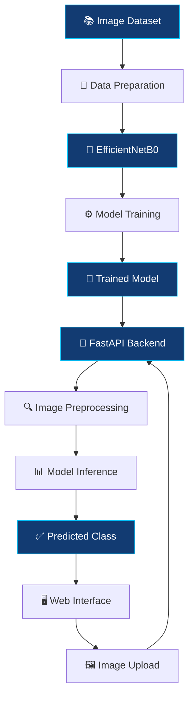

<div align="center">


<br/>

### 🔍 Exploring Image Authenticity Through Deep Learning

<p>
  
  
  
  
</p>

<p>
  <b>A deep learning project for classifying images as real or AI-generated.</b>
  <br/>
  Built with TensorFlow/Keras and designed to make image classification accessible through a web interface.
</p>

<br/>

<a href="#-overview">
  
</a>
<a href="#-technology-stack">
  
</a>
<a href="#-author">
  
</a>

<br/>

---

</div>

## 📑 Table of Contents

- [🌌 Overview](#-overview)
- [🎯 Problem Statement](#-problem-statement)
- [✨ Key Features](#-key-features)
- [🧠 Model and Methodology](#-model-and-methodology)
- [🔄 Project Workflow](#-project-workflow)
- [🛠️ Technology Stack](#️-technology-stack)
- [📂 Repository Contents](#-repository-contents)
- [🚀 Getting Started](#-getting-started)
- [📊 Evaluation](#-evaluation)
- [⚠️ Limitations](#️-limitations)
- [🔮 Future Improvements](#-future-improvements)
- [👨‍💻 Author](#-author)
- [📜 Disclaimer](#-disclaimer)

---

## 🌌 Overview

**DeepDetect AI** is a Computer Vision project that explores the classification of images into two categories:

- 🟢 **Real Image**
- 🟣 **AI-Generated Image**

The project uses a deep learning model built with **TensorFlow/Keras** and the **EfficientNetB0** architecture.

The model-training workflow is developed in Google Colab. The broader project also includes a web application that allows users to upload an image and view the model's predicted class.

The goal is to explore how deep learning can be applied to image classification and how a trained model can be integrated into an accessible application.

<div align="center">

| 🔬 Research | 🧠 Intelligence | 🌐 Accessibility |
|:---:|:---:|:---:|
| Image classification | Deep learning | Web-based predictions |

</div>

---

## 🎯 Problem Statement

AI-generated images are becoming increasingly realistic. Distinguishing generated images from real photographs can therefore be challenging through visual inspection alone.

DeepDetect AI explores this challenge as a **binary image-classification problem**.

Given an input image, the trained model processes its visual information and predicts one of the two classes used during training.

> **Objective:** Develop a practical image-classification workflow that connects deep learning experimentation with an accessible user interface.

---

## ✨ Key Features

<table>
<tr>
<td width="50%" valign="top">

### 🧠 Deep Learning
Uses TensorFlow/Keras with the EfficientNetB0 architecture for image classification.

</td>
<td width="50%" valign="top">

### 🖼️ Image Processing
Prepares input images through RGB conversion, resizing, and pixel-value scaling.

</td>
</tr>
<tr>
<td width="50%" valign="top">

### 🌐 Web Interface
Provides an interface for uploading images and viewing prediction results.

</td>
<td width="50%" valign="top">

### ⚡ Prediction API
Uses FastAPI to expose image-prediction functionality through a backend endpoint.

</td>
</tr>
<tr>
<td width="50%" valign="top">

### ☁️ Colab Workflow
Supports model development and training in a Google Colab environment.

</td>
<td width="50%" valign="top">

### 🔬 Computer Vision
Applies image classification techniques to the problem of distinguishing real and AI-generated images.

</td>
</tr>
</table>

---

## 🧠 Model and Methodology

### Architecture

DeepDetect AI uses **EfficientNetB0**, a convolutional neural network architecture, with TensorFlow/Keras.

The training workflow uses a pretrained EfficientNetB0 model. The final classification setup and training configuration should be verified against the notebook before being documented in greater detail.

### 🖼️ Image Preprocessing

The prediction pipeline prepares an image using the following steps:

1. Load the uploaded image.
2. Convert it to RGB format.
3. Resize it to **224 × 224 pixels**.
4. Scale pixel values by dividing by 255.
5. Add the batch dimension expected by the model.
6. Run inference and interpret the model output.

### 🔬 Classification

The model produces an output that the application uses to determine the predicted class.

The displayed result represents a **model prediction**, not a guaranteed determination of image authenticity.

<div align="center">

```text
       INPUT IMAGE
            │
            ▼
    Image Preprocessing
       RGB Conversion
       Resize 224×224
       Pixel Scaling
            │
            ▼
    EfficientNetB0 Model
            │
            ▼
      Model Prediction
            │
       ┌────┴────┐
       ▼         ▼
      Real    AI-Generated
```

</div>

---

## 🔄 Project Workflow

The project connects model development with application-based inference.



---

## 🛠️ Technology Stack

<div align="center">

| Technology | Role |
|:---|:---|
|  | Primary programming language |
|  | Deep learning framework |
|  | Model development and training |
| EfficientNetB0 | Image-classification architecture |
|  | Numerical operations |
| Pillow | Image loading and processing |
|  | Prediction API |
|  | Web page structure |
|  | Interface styling |
|  | Frontend interaction |
|  | Notebook development |

</div>

---

## 📂 Repository Contents

The repository currently includes the model-training notebook:

```text
DeepDetect-AI/
│
├── README.md
└── notebooks/
    └── DeepDetect_Training.ipynb
```

The notebook contains the starting point for exploring the model-training workflow.

Additional project files should be documented here when they are actually added to this repository.

---

## 🚀 Getting Started

### 1️⃣ Clone the Repository

Replace `YOUR_GITHUB_USERNAME` with your GitHub username.

```bash
git clone https://github.com/YOUR_GITHUB_USERNAME/DeepDetect-AI.git
cd DeepDetect-AI
```

### 2️⃣ Open the Training Notebook

Navigate to:

```text
notebooks/DeepDetect_Training.ipynb
```

You can inspect the notebook directly on GitHub or open it in Google Colab.

### 3️⃣ Run in Google Colab

1. Open [Google Colab](https://colab.research.google.com/).
2. Import the notebook from GitHub.
3. Configure the required runtime.
4. Provide access to the dataset using the appropriate secure method.
5. Run the notebook cells in the intended order.

**Note:** The exact dependencies, dataset setup, and execution steps depend on the notebook's current contents. Verify these requirements before running it in a new environment.

---

## 📊 Evaluation

Reliable evaluation is essential for image-classification projects.

Useful metrics include:

- **Accuracy:** Overall proportion of correct predictions.
- **Precision:** Proportion of positive predictions that are correct.
- **Recall:** Proportion of actual positive examples correctly identified.
- **F1-score:** Harmonic mean of precision and recall.
- **Confusion matrix:** Distribution of correct and incorrect predictions across the classes.

Actual results should be added after confirming the evaluation output for the model version being published.

No final performance claim is made here without verified evaluation evidence.

---

## ⚠️ Limitations

- Classification results depend on the quality and representativeness of the training data.
- Images from unfamiliar sources or generation methods may produce incorrect predictions.
- Image resizing and preprocessing can affect the information available to the model.
- A prediction score is not necessarily a calibrated probability.
- The model should not be treated as definitive forensic evidence of image authenticity.

---

## 🔮 Future Improvements

Potential directions for further development include:

- 📊 Publish verified evaluation metrics and visualizations.
- 🧪 Test generalization on diverse, unseen images.
- ⚖️ Evaluate precision, recall, F1-score, and class-wise errors.
- 🧠 Explore methods to improve model generalization.
- ⚡ Investigate inference speed and resource requirements.
- 🌐 Continue improving the usability of the web application.

These are possible future directions, not claims about features already implemented.

---

## 👨‍💻 Author

<div align="center">

### Aryan Mishra

**B.Tech — Computer Science and Engineering**

Interested in Computer Vision, Deep Learning, and Artificial Intelligence.

<br/>

<a href="https://github.com/YOUR_GITHUB_USERNAME">
  
</a>

</div>

---

## 📜 Disclaimer

DeepDetect AI is an educational and technical project exploring deep learning-based image classification.

Its predictions can be incorrect and should not be used as the sole basis for consequential decisions about image authenticity. The system does not guarantee that an image is real or AI-generated.

---

<div align="center">


### 🔍 DeepDetect AI

*Exploring the intersection of Computer Vision and Deep Learning.*

**Built with curiosity. Driven by experimentation.**

⭐ If you find this project interesting, consider starring the repository!

</div>
