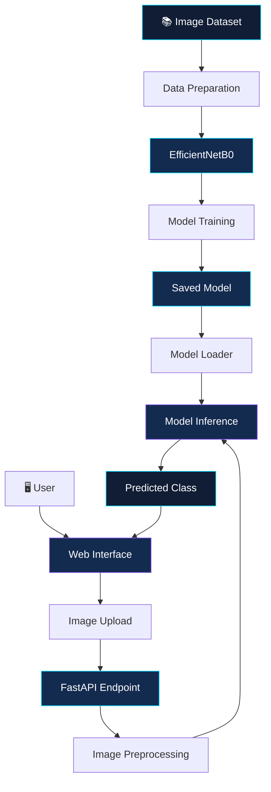

<div align="center">


<br/>

<p>
  
  
  
</p>

<p>
  
  
  
  
  
</p>

### Detect patterns. Classify images. Explore authenticity.

*A deep learning-based Computer Vision project for classifying images as real or AI-generated.*

<br/>

<a href="#-overview"><strong>Explore Project</strong></a>
&nbsp; ◆ &nbsp;
<a href="#-model-pipeline"><strong>Model Pipeline</strong></a>
&nbsp; ◆ &nbsp;
<a href="#-technology-stack"><strong>Technology Stack</strong></a>

<br/><br/>


</div>

---

## 🧭 Overview

**DeepDetect AI** explores the application of deep learning to image authenticity classification.

The project uses a TensorFlow/Keras model based on **EfficientNetB0** to classify images into two categories:

| Class | Description |
|:---|:---|
| 🟢 **Real** | Image classified into the real-image class |
| 🟣 **AI-Generated** | Image classified into the AI-generated-image class |

The model-training workflow is developed in Google Colab. The broader application integrates image preprocessing, model inference, a FastAPI backend, and a web interface for image uploads and prediction display.

> **Core idea:** Connect deep learning experimentation with a practical image-classification application.

<div align="center">

| 🧠 Deep Learning | 🖼️ Computer Vision | 🌐 Application Integration |
|:---:|:---:|:---:|
| EfficientNetB0 | Image preprocessing | FastAPI and web UI |

</div>

---

## 🎯 Problem Statement

The growing quality of AI-generated imagery makes visual distinctions between generated and authentic photographs increasingly difficult.

DeepDetect approaches this challenge as a binary classification task: process an input image and predict which of the two training classes it most closely matches.

### Project Objectives

- 🧠 Develop an image classifier using TensorFlow/Keras.
- 🔬 Explore EfficientNetB0 for visual feature extraction and classification.
- 🖼️ Establish a consistent image preprocessing pipeline.
- ⚙️ Connect the trained model to a prediction API.
- 🌐 Provide a web interface for submitting images and viewing predictions.
- 📊 Evaluate model performance using appropriate classification metrics.

---

## ✨ System Highlights

<table>
<tr>
<td width="50%" valign="top">

### 🧠 Model Development

A deep learning workflow based on EfficientNetB0 and TensorFlow/Keras.

**Focus:** Image classification and model experimentation.

</td>
<td width="50%" valign="top">

### 🔍 Image Preprocessing

Standardized input preparation before inference.

**Focus:** RGB conversion, image resizing, and pixel scaling.

</td>
</tr>
<tr>
<td width="50%" valign="top">

### ⚡ Prediction Backend

A FastAPI application that exposes image-prediction functionality.

**Focus:** Receiving images and returning prediction results.

</td>
<td width="50%" valign="top">

### 🖥️ Web Interface

A frontend for image uploads, image previews, and prediction display.

**Focus:** Making model inference accessible through a browser.

</td>
</tr>
</table>

---

## 🧠 Model Architecture

### EfficientNetB0

DeepDetect uses **EfficientNetB0**, a convolutional neural network architecture, within a TensorFlow/Keras classification workflow.

The project uses a pretrained EfficientNetB0 model. Details such as the final classification head, fine-tuning configuration, optimizer, and training schedule should be taken from the actual training notebook.

### Model Pipeline

<div align="center">

```text
                 INPUT IMAGE
                      │
                      ▼
            ┌──────────────────┐
            │  Image Loading   │
            └────────┬─────────┘
                     ▼
            ┌──────────────────┐
            │  RGB Conversion  │
            └────────┬─────────┘
                     ▼
            ┌──────────────────┐
            │ Resize: 224×224  │
            └────────┬─────────┘
                     ▼
            ┌──────────────────┐
            │ Pixel Scaling /255│
            └────────┬─────────┘
                     ▼
            ┌──────────────────┐
            │  EfficientNetB0  │
            │   Classification │
            └────────┬─────────┘
                     ▼
            ┌──────────────────┐
            │ Predicted Class  │
            └──────────────────┘
```

</div>

### Input Specifications

| Parameter | Value |
|:---|:---|
| Image color format | RGB |
| Input dimensions | 224 × 224 pixels |
| Input representation | Batched numerical array |
| Pixel scaling | Divide pixel values by 255 |
| Model framework | TensorFlow/Keras |
| Architecture | EfficientNetB0 |
| Task | Binary image classification |

---

## 🔄 End-to-End System Architecture

The overall system connects model training to application-based inference.



**Training phase:** Prepare the dataset, train or fine-tune the model, and save the selected model.

**Inference phase:** Receive an uploaded image, preprocess it, perform inference, and return the prediction to the interface.

---

## 🛠️ Technology Stack

<div align="center">

| Technology | Application |
|:---|:---|
|  | Core programming language |
|  | Deep learning framework |
|  | Model development |
| EfficientNetB0 | CNN architecture |
|  | Array operations |
| Pillow | Image loading and preprocessing |
|  | Prediction API |
|  | Web structure |
|  | Interface styling |
|  | Frontend interaction |
|  | Model training environment |

</div>

---

## 📂 Repository Structure

The repository currently includes the training notebook.

```text
DeepDetect-AI/
│
├── README.md
│
└── notebooks/
    └── DeepDetect_Training.ipynb
```

The notebook is the entry point for exploring the model-training workflow.

As additional files are added, this section can be updated to document the actual backend, frontend, configuration files, and model artifacts included in the repository.

---

## 🚀 Getting Started

### 1. Clone the repository

```bash
git clone https://github.com/YOUR_GITHUB_USERNAME/DeepDetect-AI.git
cd DeepDetect-AI
```

Replace `YOUR_GITHUB_USERNAME` with your GitHub username.

### 2. Open the notebook

Navigate to:

```text
notebooks/DeepDetect_Training.ipynb
```

Open it on GitHub to review the code or import it into Google Colab for execution.

### 3. Configure the environment

Before running the notebook:

1. Select an appropriate Colab runtime.
2. Configure access to the dataset.
3. Provide credentials through a secure method if required.
4. Install any dependencies missing from the selected runtime.
5. Run the notebook cells in order.

**Reproducibility note:** Exact dependency versions and dataset configuration should be documented from the actual notebook to ensure that another user can reproduce the experiment.

---

## 📊 Model Evaluation

Model quality should be assessed using a held-out test dataset and appropriate classification metrics.

| Metric | What it measures |
|:---|:---|
| Accuracy | Overall proportion of correct predictions |
| Precision | Reliability of positive-class predictions |
| Recall | Proportion of positive examples correctly identified |
| F1-score | Balance between precision and recall |
| Confusion matrix | Correct and incorrect predictions by class |

Evaluation results should be reported for the specific model checkpoint and test dataset used.

No final accuracy or performance guarantee is claimed in this README without a verified final evaluation.

---

## ⚠️ Limitations and Responsible Use

- Model performance depends on the diversity and quality of training data.
- Unseen image-generation methods may produce unfamiliar patterns.
- Resizing and preprocessing may discard useful image information.
- A model's confidence score, if displayed, should not automatically be interpreted as a calibrated probability.
- A classification result does not establish an image's provenance or provide definitive forensic proof.

DeepDetect is an experimental image-classification project, not a guaranteed authenticity-verification system.

---

## 🔮 Future Research Directions

Potential improvements include:

- **Generalization:** Evaluate performance on diverse, previously unseen datasets.
- **Evaluation:** Publish class-wise precision, recall, F1-score, and confusion matrices.
- **Robustness:** Investigate how compression, resizing, and other transformations affect predictions.
- **Efficiency:** Measure inference time and computational requirements.
- **Interpretability:** Explore techniques for investigating the visual patterns used by the classifier.
- **Reproducibility:** Document the dataset, preprocessing, training configuration, and selected checkpoint.

These are proposed directions for future development, not claims of existing functionality.

---

## 👨‍💻 About the Developer

<div align="center">


### Aryan Mishra

**B.Tech — Computer Science and Engineering**

Interested in Computer Vision, Deep Learning, and Artificial Intelligence.

<a href="https://github.com/YOUR_GITHUB_USERNAME">
  
</a>

</div>

---

## 📜 Disclaimer

DeepDetect AI is developed for educational and experimental purposes.

The model produces predictions based on learned patterns. It may incorrectly classify real or AI-generated images and should not be used as the sole basis for consequential decisions.

---

<div align="center">


### DeepDetect AI

**Computer Vision · Deep Learning · Image Classification**

*Turning experimentation into practical AI.*

<sub>Designed and developed by Aryan Mishra</sub>

</div>
