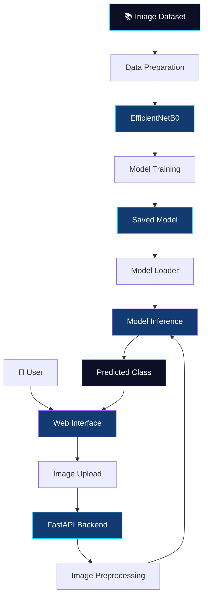

<div align="center">


<br/>

### 🔍 Exploring Image Authenticity Through Deep Learning

<p>
  
  
  
</p>

<p>
  
  
  
  
  
</p>

### Detect patterns. Classify images. Explore authenticity.

*A deep learning-based Computer Vision project for classifying images as real or AI-generated.*

<br/>

<a href="#-overview">
  
</a>
<a href="#-model-architecture">
  
</a>
<a href="#-technology-stack">
  
</a>

<br/><br/>


<br/>

---

</div>

## 📑 Table of Contents

- [🌌 Overview](#-overview)
- [🎯 Problem Statement](#-problem-statement)
- [✨ Project Objectives](#-project-objectives)
- [🚀 Key Features](#-key-features)
- [🧠 Model Architecture](#-model-architecture)
- [🔬 Image Preprocessing](#-image-preprocessing)
- [🔄 System Architecture](#-system-architecture)
- [🛠️ Technology Stack](#️-technology-stack)
- [📂 Repository Structure](#-repository-structure)
- [⚙️ Getting Started](#️-getting-started)
- [📊 Evaluation](#-evaluation)
- [⚠️ Limitations](#️-limitations)
- [🔮 Future Improvements](#-future-improvements)
- [👨‍💻 About the Developer](#-about-the-developer)
- [📜 Disclaimer](#-disclaimer)

---

## 🌌 Overview

**DeepDetect AI** is a Computer Vision project that explores the classification of images into two categories:

- 🟢 **Real Image**
- 🟣 **AI-Generated Image**

The project uses a deep learning model built with **TensorFlow/Keras** and the **EfficientNetB0** architecture.

The training workflow is developed in Google Colab. The broader application also integrates a FastAPI backend and a web interface through which users can upload images and view prediction results.

### Project at a Glance

<div align="center">

<table>
<tr>
<td align="center" width="33%">

### 🧠

**Deep Learning**

EfficientNetB0

</td>
<td align="center" width="33%">

### 🖼️

**Computer Vision**

Image Classification

</td>
<td align="center" width="33%">

### 🌐

**Application**

Web-Based Predictions

</td>
</tr>
</table>

</div>

---

## 🎯 Problem Statement

AI-generated images are becoming increasingly realistic, making it difficult to distinguish generated imagery from real photographs through visual inspection alone.

DeepDetect approaches this challenge as a **binary image-classification problem**.

Given an input image, the model processes its visual information and predicts which of the two classes it most closely matches.

> **Project goal:** Explore deep learning techniques for image classification and integrate the trained model into an accessible application.

---

## ✨ Project Objectives

- 🧠 Develop an image-classification workflow using TensorFlow/Keras.
- 🔬 Explore EfficientNetB0 for visual feature extraction and classification.
- 🖼️ Apply consistent image preprocessing before model inference.
- ⚙️ Integrate prediction functionality through a FastAPI backend.
- 🌐 Provide a browser-based interface for image uploads and predictions.
- 📊 Evaluate the model using appropriate classification metrics.

---

## 🚀 Key Features

<table>
<tr>
<td width="50%" valign="top">

### 🧠 Deep Learning

Uses TensorFlow/Keras with the EfficientNetB0 architecture.

**Focus:** Image classification and model development.

</td>
<td width="50%" valign="top">

### 🖼️ Image Processing

Prepares input images through RGB conversion, resizing, and pixel scaling.

**Focus:** Consistent input preprocessing.

</td>
</tr>
<tr>
<td width="50%" valign="top">

### ⚡ Prediction Backend

Uses FastAPI to expose image-prediction functionality.

**Focus:** Receiving images and returning predictions.

</td>
<td width="50%" valign="top">

### 🌐 Web Interface

Provides a user interface for image uploads, previews, and prediction display.

**Focus:** Accessible model interaction.

</td>
</tr>
</table>

---

## 🧠 Model Architecture

### EfficientNetB0

DeepDetect uses **EfficientNetB0**, a convolutional neural network architecture, within a TensorFlow/Keras classification workflow.

The project uses a pretrained EfficientNetB0 model. The exact classification head, optimizer, training schedule, and fine-tuning configuration should be confirmed from the training notebook.

### Model Workflow

<div align="center">

```text
              ┌───────────────────┐
              │    Input Image    │
              └─────────┬─────────┘
                        ▼
              ┌───────────────────┐
              │ Image Preprocessing│
              └─────────┬─────────┘
                        ▼
              ┌───────────────────┐
              │   EfficientNetB0  │
              │  Deep Learning    │
              └─────────┬─────────┘
                        ▼
              ┌───────────────────┐
              │ Model Prediction  │
              └─────────┬─────────┘
                        ▼
               ┌────────┴────────┐
               ▼                 ▼
        ┌─────────────┐   ┌─────────────┐
        │    Real     │   │ AI-Generated│
        └─────────────┘   └─────────────┘
```

</div>

---

## 🔬 Image Preprocessing

The prediction pipeline prepares uploaded images before passing them to the model.

| Step | Operation | Purpose |
|:---:|---|---|
| 01 | Image loading | Read the input image |
| 02 | RGB conversion | Standardize the image color format |
| 03 | Image resizing | Resize to 224 × 224 pixels |
| 04 | Pixel scaling | Divide pixel values by 255 |
| 05 | Batch preparation | Add the required batch dimension |
| 06 | Model inference | Generate the model output |
| 07 | Result interpretation | Determine the predicted class |

**Input specifications**

- **Color format:** RGB
- **Image dimensions:** 224 × 224 pixels
- **Pixel scaling:** Division by 255
- **Framework:** TensorFlow/Keras
- **Architecture:** EfficientNetB0

---

## 🔄 System Architecture

The overall project connects model training to application-based inference.



### Training Phase

The model-training workflow prepares the dataset, trains or fine-tunes the model, and saves the selected checkpoint.

### Inference Phase

The application receives an image, preprocesses it, runs model inference, and returns the predicted class to the interface.

---

## 🛠️ Technology Stack

<div align="center">

| Technology | Purpose |
|:---|:---|
|  | Programming language |
|  | Deep learning framework |
|  | Model development |
| EfficientNetB0 | CNN architecture |
|  | Numerical operations |
| Pillow | Image loading and preprocessing |
|  | Prediction API |
|  | Web page structure |
|  | Interface styling |
|  | Frontend interaction |
|  | Model development and training |

</div>

---

## 📂 Repository Structure

The repository currently contains the model-training notebook.

```text
DeepDetect-AI/
│
├── README.md
│
└── notebooks/
    └── DeepDetect_Training.ipynb
```

The notebook provides the starting point for exploring the training workflow.

As the repository evolves, this section can be updated to reflect additional source files, configuration files, and other project artifacts actually committed to GitHub.

---

## ⚙️ Getting Started

### 1. Clone the Repository

Replace `YOUR_GITHUB_USERNAME` with your GitHub username.

```bash
git clone https://github.com/YOUR_GITHUB_USERNAME/DeepDetect-AI.git
cd DeepDetect-AI
```

### 2. Open the Training Notebook

Navigate to:

```text
notebooks/DeepDetect_Training.ipynb
```

You can inspect the notebook directly on GitHub or import it into Google Colab.

### 3. Configure the Environment

Before running the notebook:

1. Select an appropriate Colab runtime.
2. Configure access to the dataset.
3. Store credentials securely if required.
4. Install any dependencies that are not already available.
5. Execute the notebook cells in the intended order.

**Note:** Exact dependency versions, dataset configuration, and execution instructions should be verified from the notebook to support reproducibility.

---

## 📊 Evaluation

Model quality should be assessed using a held-out test dataset and appropriate classification metrics.

| Metric | Description |
|---|---|
| Accuracy | Overall proportion of correct predictions |
| Precision | Reliability of positive-class predictions |
| Recall | Proportion of actual positive examples correctly identified |
| F1-score | Balance between precision and recall |
| Confusion matrix | Distribution of correct and incorrect predictions |

Final metrics should be reported only after confirming the results for the specific model checkpoint and test dataset being published.

---

## ⚠️ Limitations

- Performance depends on the quality and diversity of the training dataset.
- Unseen image-generation methods may produce unfamiliar patterns.
- Image transformations can affect classification results.
- Model confidence scores are not necessarily calibrated probabilities.
- A prediction does not establish an image's provenance or provide definitive forensic proof.

DeepDetect is an experimental image-classification system, not a guaranteed image-authenticity verification tool.

---

## 🔮 Future Improvements

Potential directions for further development include:

- 📊 Publishing verified evaluation metrics and visualizations.
- 🧪 Testing generalization on diverse, unseen datasets.
- ⚖️ Evaluating class-wise precision, recall, and F1-score.
- 🔬 Investigating robustness to image compression and transformations.
- ⚡ Measuring inference speed and computational requirements.
- 🧠 Exploring model interpretability techniques.
- 📖 Documenting training configurations for reproducibility.

These are proposed future directions, not claims of existing functionality.

---

## 👨‍💻 About the Developer

<div align="center">


### Aryan Mishra

**B.Tech — Computer Science and Engineering**

Interested in Computer Vision, Deep Learning, and Artificial Intelligence.

<br/>

<a href="https://github.com/YOUR_GITHUB_USERNAME">
  
</a>

</div>

---

## 📜 Disclaimer

DeepDetect AI is an educational and experimental Computer Vision project.

The model may incorrectly classify real or AI-generated images. Its predictions should not be treated as definitive evidence of authenticity or used as the sole basis for consequential decisions.

---

<div align="center">


### 🔍 DeepDetect AI

**Computer Vision · Deep Learning · Image Classification**

*Built with curiosity. Driven by experimentation.*

<sub>Designed and developed by Aryan Mishra</sub>

<br/>

<a href="#-overview">⬆ Back to Overview</a>

</div>
